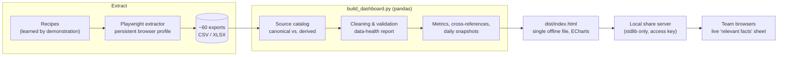

# Órbita — case study

**An internal operations dashboard I built during my engineering internship: it turns ~60 report exports from several corporate systems into one offline HTML file that the team uses to run its daily management meeting.**

> The production code and data belong to the company and stay there. This repository has the case study (problem, architecture, decisions) and the one part that is fully generic: a **record-and-replay toolkit** that learns how to download a report by watching you do it once, and maps where every downloaded file comes from in the page's network traffic. → [`toolkit/`](toolkit/)

## The problem

The team's daily management meeting follows a fixed weekly agenda (delivery, safety and people, quality), and every topic depended on reports scattered across different internal web portals. Before each meeting someone had to open each portal, set filters, export CSV/XLSX files and assemble the numbers by hand. Exports came with inconsistent names, dates and formats, some portals silently returned empty tables while still loading, and nobody could easily trace a number on the slide back to the records behind it.

## What I built

- **One-click refresh.** A single launcher runs the extractor and rebuilds the dashboard. With no input for 20 seconds it takes the daily default.
- **Source catalog instead of hard-coded files.** Each of the ~60 sources is declared in JSON: filename patterns (dates in names allowed), whether it is *canonical* (feeds indicators) or a *derived cut* (validated against its canonical source and never double-counted), staleness limits, and optional sources that degrade to "not mapped" instead of breaking the build.
- **Data-health report on every run.** Every source read and every correction is written to a report so the numbers can be audited: part numbers that a spreadsheet had turned into dates before export, status flags recomputed from the actual dates, per-department files merged with duplicated rows removed, derived cuts checked to be 100% contained in their canonical source, stale or failed extractions flagged. The largest sources have 60k+ rows, and one consolidates 166k workflow stages into 160k distinct documents.
- **Every number is clickable.** Indicators drill down to the exact records behind them, and daily snapshots let each indicator show its change since the previous meeting.
- **Self-contained output.** The dashboard is one HTML file (~50 MB, ~10 MB compressed over the network) that opens without a server or internet, with a presentation mode for the meeting and a PowerPoint export of the facts sheet.
- **Team sharing without infrastructure.** A small server built only on Python's standard library serves the same file on the local network behind an access key, and turns the "relevant facts" sheet into a shared document with revision numbers and conflict detection. When the dashboard is rebuilt, open browsers get a "dashboard updated, reload" notice.
- **Privacy by default.** A `--sem-nomes` build strips people's names and logins before the file is sent to anyone outside the team.

## Engineering decisions worth discussing

| Decision | Why |
|---|---|
| Static HTML instead of a BI server | No new infrastructure or licenses to approve. The file can be archived, emailed or opened on a locked-down laptop. |
| Declarative source catalog | Portals change export names and columns. Catalog changes are config edits, not code changes, and the build fails loudly only on missing *required* sources. |
| "Loading" is not "empty" | Several portals render the same overlay for "loading" and "no rows". The extractor waits on progress indicators before deciding a report is empty, and saves a screenshot and the HTML of any page that fails. |
| Learn by demonstration | New reports are added by recording the clicks once (recipes), so teammates don't need to write selectors. Dates typed during the recording become relative (`start of month`, `today-1`), so the recipe keeps working next month. |
| Map the network before replacing clicks | The network map shows which API call each downloaded file was assembled from and whether every column matches. That is the evidence needed to replace a slow click-through with one direct request. |
| Never store secrets or values | Recipes and network maps keep URLs, filter codes, field names and counts, but never cookies, auth headers, tokens, typed passwords or data values, so they can be shared for debugging. |

## Scale

About 11.6k lines of Python (pandas, Playwright) and 5k lines of JavaScript/CSS, built and maintained by me in my first months as an intern, alongside the day-to-day work.

## The toolkit in this repository

[`toolkit/`](toolkit/) contains the generic, company-independent part of the extractor, refactored to run on its own:

- `receitas.py`: records a download flow once, then replays it with relative dates (`--repetir NAME`).
- `gravar_pagina.py`: records what a page requests from its server and the steps up to a download, like the DevTools Network tab but safe to share.
- `mapa_rede.py`: privacy filter and analyzer used by both, matching downloaded files against JSON/HTML responses.
- `tests/`: unit tests for date handling and the privacy filter, plus an end-to-end test that teaches a recipe on a local page, replays it in a fresh browser profile and checks the CSV and the network map.

Code comments and CLI messages are in Portuguese, as in the original tool. See [toolkit/README.md](toolkit/README.md) for usage.
